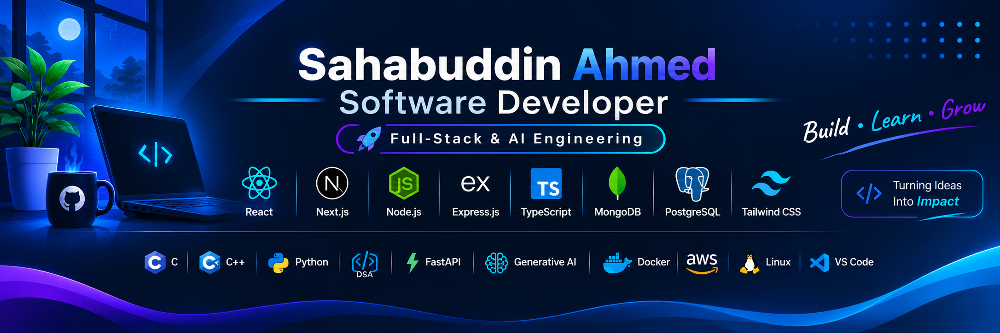

<h1 align="center">
  
</h1>

  

  

## 🧑‍💻 About Me

I'm a passionate **Software Developer** who enjoys exploring technology, solving problems, and turning ideas into reality. I'm driven by curiosity and a continuous learning mindset, with a particular interest in **Backend Engineering, System Design, and Generative AI**. I believe in writing clean, maintainable code and continuously growing as a software engineer. Beyond coding, I enjoy exploring new technologies and understanding how things work behind the scenes.

- 🌱 I’m currently learning **Generative AI**
- 👯 I’m looking to collaborate on **Open Source Projects**
- 💬 Ask me about **Software Development**
- 📫 How to reach me: **[sahabuddin.ahmed2125@gmail.com](mailto:sahabuddin.ahmed2125@gmail.com)**
- ⚡ Fun fact: **After watching Mr. Robot, I got so fascinated by the tech world that I decided to start learning web development! Now, I’m diving into coding like Elliot Alderson (minus the hacking 😅), and loving every moment of it!**

## 🌐 Connect with Me

  
  
  
  

## 💼 What I Do

- **Frontend Development:** Build responsive, accessible, and interactive user interfaces using React, Next.js, and Tailwind CSS.
- **Backend Development:** Develop RESTful APIs, authentication systems, and scalable backend services using Node.js, Express.js, and TypeScript.
- **Database Engineering:** Design and manage relational and NoSQL databases using PostgreSQL, MongoDB, and Redis.
- **Problem Solving:** Apply Data Structures & Algorithms and programming fundamentals using C, C++, and Python.
- **AI Engineering:** Explore Generative AI, LLMs, RAG, and AI-powered application development.
- **DevOps & Deployment:** Work with Docker, Linux, AWS, and CI/CD workflows.

## 🛠️ Tech Stack & Tools

### 💻 Programming Languages

  

### 🎨 Frontend Development

  

### ⚙️ Backend Development

  

### 🗄️ Database & ORM

  

  <strong>Also exploring:</strong> Drizzle ORM, pgvector, Vector Databases

### 🤖 AI Engineering

  
  
  

  LLMs · RAG · Embeddings · Vector Stores 
  AI Agents · Multi-Agent Systems · MCP · OpenRouter API

### ☁️ DevOps, Cloud & Infrastructure

  

  <strong>Also working with:</strong> Docker Compose · AWS IAM · Amazon S3 · Amazon EC2 · VPS · Let's Encrypt

### 🧪 Testing & Developer Tools

  

  <strong>Also using:</strong> Supertest · Bruno · Swagger · Cloudinary · Claude Code · OpenCode

## 📈 GitHub Stats

  

  

## 🔥 Most Used Languages

   

